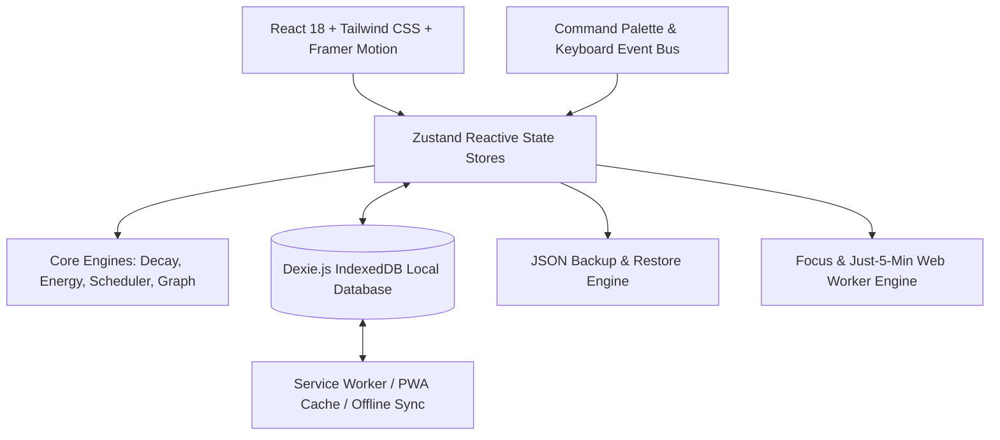

# Momentum — Implementation Plan & Architecture Specification

## 1. Executive Overview & Design Philosophy

**Momentum** is a local-first, human-centric productivity web application designed to combat burnout, decision fatigue, and task paralysis. Unlike traditional checkbox lists (Todoist, TickTick, Microsoft To Do) that encourage endless task hoarding, Momentum introduces intentional constraints, biological energy alignment, forgiving momentum mechanics, and intelligent task decay.

### Distinct Visual & UX Identity: "Zen Momentum"
- **Aesthetic Direction**: High-end Japanese editorial minimalism blended with warm tactile interfaces (stone, charcoal, sage, warm amber accents).
- **Typography**: Refined modern typography using *Plus Jakarta Sans* / *Outfit* for crisp hierarchy and *JetBrains Mono* for timers and metrics.
- **Micro-Interactions**: Gentle Framer Motion spring physics, subtle task wilting/decay effects, tactile state changes, and smooth page transitions.
- **Color Themes**:
  - **Dark ("Kyoto Night")**: Deep obsidian `#0D0F12`, elevated slate cards `#16191E`, soft border `#252932`, energetic accents in luminous emerald `#10B981`, amber `#F59E0B`, and rose `#F43F5E`.
  - **Light ("Washi Paper")**: Calming warm cream `#F9F9F8`, pure card `#FFFFFF`, subtle borders `#E4E4E7`, soft ink typography `#18181B`.

---

## 2. System Architecture



### Local-First Persistence Strategy
- **Primary Storage**: IndexedDB managed via **Dexie.js** (typed schemas, reactive live queries, zero external backend requirement).
- **State Hydration**: Zustand stores hydrate on mount from Dexie and propagate updates synchronously to UI while saving asynchronously with optimistic updates.
- **Offline & Installability**: `vite-plugin-pwa` with CacheFirst for static assets and NetworkFirst/IndexedDB fallback for dynamic state.
- **Data Portability**: Full JSON export and schema-validated import with conflict resolution.

---

## 3. Data Model & Dexie Schema

### 3.1 TypeScript Definitions (`src/types/index.ts`)

```typescript
export type EnergyLevel = 'low' | 'medium' | 'high';

export type SnoozeReason = 
  | 'too_big' 
  | 'not_in_mood' 
  | 'waiting_on_someone' 
  | 'forgot' 
  | 'not_important';

export type TaskStatus = 'inbox' | 'today_main' | 'today_bonus' | 'completed' | 'archived';

export interface Subtask {
  id: string;
  title: string;
  completed: boolean;
  estimatedMinutes?: number;
}

export interface Task {
  id: string;
  title: string;
  description?: string;
  projectId?: string;
  tags: string[];
  
  // Status & Priority
  status: TaskStatus;
  order: number;
  
  // Energy & Estimation
  energyLevel: EnergyLevel; // 'low' | 'medium' | 'high'
  estimatedMinutes: number; // e.g. 15, 30, 45, 60
  actualMinutesSpent: number; // accumulated focus time
  
  // Dates & Decay
  createdAt: number;
  updatedAt: number;
  lastInteractedAt: number; // used to calculate visual decay & wilting
  dueDate?: number; // timestamp
  completedAt?: number; // timestamp
  
  // Dependencies (DAG)
  blockedByTaskIds: string[]; // IDs of tasks that must be completed first
  
  // Subtasks
  subtasks: Subtask[];
  
  // Procrastination Tracking
  snoozeHistory: {
    timestamp: number;
    reason: SnoozeReason;
    notes?: string;
  }[];
  
  // Decay triage flag
  decayPromptDismissedAt?: number;
}

export interface Project {
  id: string;
  name: string;
  color: string;
  icon?: string;
  order: number;
}

export interface FocusSession {
  id: string;
  taskId: string;
  startedAt: number;
  endedAt: number;
  durationMinutes: number;
  mode: 'standard' | 'just_5_minutes';
  completedTask: boolean;
}

export interface UserStats {
  id: 'current_user';
  streakCount: number;
  lastActiveDate: string; // 'YYYY-MM-DD'
  missedGraceDays: number; // 0 or 1 (allow 1 skip without streak reset)
  totalFocusMinutes: number;
  totalCompletedTasks: number;
  historicalMultiplier: number; // e.g. 1.45 (actual / estimated)
}
```

### 3.2 Dexie Database Schema (`src/db/index.ts`)
```typescript
import Dexie, { Table } from 'dexie';

export class MomentumDatabase extends Dexie {
  tasks!: Table<Task, string>;
  projects!: Table<Project, string>;
  focusSessions!: Table<FocusSession, string>;
  stats!: Table<UserStats, string>;

  constructor() {
    super('MomentumDB');
    this.version(1).stores({
      tasks: 'id, projectId, status, energyLevel, dueDate, completedAt, lastInteractedAt, *tags, *blockedByTaskIds',
      projects: 'id, order',
      focusSessions: 'id, taskId, startedAt',
      stats: 'id'
    });
  }
}

export const db = new MomentumDatabase();
```

---

## 4. Proposed Folder Structure

```
e:/To-do-List/
├── index.html
├── package.json
├── tsconfig.json
├── vite.config.ts
├── tailwind.config.js
├── postcss.config.js
├── public/
│   ├── favicon.svg
│   ├── pwa-192x192.png
│   ├── pwa-512x512.png
│   └── manifest.webmanifest
├── src/
│   ├── main.tsx
│   ├── App.tsx
│   ├── index.css
│   ├── types/
│   │   └── index.ts
│   ├── db/
│   │   ├── index.ts
│   │   └── seed.ts
│   ├── stores/
│   │   ├── useTaskStore.ts
│   │   ├── useTimerStore.ts
│   │   ├── useThemeStore.ts
│   │   ├── useUIStore.ts
│   │   └── useStatsStore.ts
│   ├── core/
│   │   ├── decayEngine.ts       # Visual age & wilting score calculation
│   │   ├── energyMatcher.ts     # "What should I do right now?" matcher
│   │   ├── ruleOfThree.ts       # Main 3 + 2 bonus validation & swap logic
│   │   ├── dependencyGraph.ts   # DAG cycle detection & blocker checks
│   │   ├── autoSplitter.ts      # Rule-based breakdown engine (LLM extensible)
│   │   ├── streakEngine.ts      # Forgiving streak algorithm (1 skip day allowed)
│   │   └── estimateAnalytics.ts # Multiplier computation & procrastination trends
│   ├── components/
│   │   ├── layout/
│   │   │   ├── Header.tsx
│   │   │   ├── Sidebar.tsx
│   │   │   └── QuickStatsBar.tsx
│   │   ├── tasks/
│   │   │   ├── TaskCard.tsx             # Interactive card with wilting visual effect
│   │   │   ├── TaskList.tsx             # Reorderable task list
│   │   │   ├── TaskModal.tsx            # Add/Edit task with all metadata
│   │   │   ├── RuleOfThreeSection.tsx   # Today's 3 Main + 2 Bonus slots
│   │   │   ├── SwapTaskModal.tsx        # Slot limit swap chooser
│   │   │   ├── DecayTriageModal.tsx     # 7-day aged task triage (Do/Shrink/Reschedule/Delete)
│   │   │   ├── SnoozeModal.tsx          # Snooze with mandatory reason selector
│   │   │   └── AutoSplitModal.tsx       # "Break it down" preview & edit
│   │   ├── modals/
│   │   │   ├── EnergyPickerModal.tsx    # "What should I do right now?" finder
│   │   │   ├── JustFiveMinutesModal.tsx # 5-min sprint timer & continuation dialog
│   │   │   ├── DependencyGraphModal.tsx # Interactive visual DAG blocker graph
│   │   │   └── ImportExportModal.tsx    # Backup & restore JSON
│   │   ├── timer/
│   │   │   ├── ActiveTimerPill.tsx      # Floating / docked focus timer
│   │   │   └── TimerCompletionModal.tsx
│   │   ├── timeline/
│   │   │   ├── WinsTimeline.tsx         # Daily completed tasks journal
│   │   │   └── StreakBadge.tsx          # Forgiving streak status indicator
│   │   ├── insights/
│   │   │   ├── InsightsView.tsx         # Procrastination breakdown & estimate vs reality
│   │   │   └── MultiplierCard.tsx
│   │   └── command/
│   │       └── CommandPalette.tsx       # Ctrl+K keyboard palette
│   └── utils/
│       ├── formatters.ts
│       └── sounds.ts                    # Optional subtle web audio clicks/chimes
└── tests/
    ├── decayEngine.test.ts
    ├── energyMatcher.test.ts
    ├── ruleOfThree.test.ts
    ├── streakEngine.test.ts
    └── dependencyGraph.test.ts
```

---

## 5. Deep-Dive on the 10 Unique Features

### 1. Energy-Based Planning ("What should I do right now?")
- **Inputs**: Current Energy (`low` ☕, `medium` ⚡, `high` 🚀) + Available Time (slider or pills: 15m, 30m, 45m, 60m, 90m+).
- **Matching Engine**: Filters tasks whose prerequisites are met (not blocked), filters for status not completed, sorts by energy match distance, time fit penalty, and due-date urgency.
- **Output**: 1 top recommendation with "Start Focus" button, plus 2 runner-ups.

### 2. Task Decay & The 7-Day Triage Ritual
- **Aging Engine**:
  - `daysUntouched = (now - task.lastInteractedAt) / (1000 * 60 * 60 * 24)`.
  - Age 0-2 days: 100% vibrant, crisp borders.
  - Age 3-6 days: Gradual opacity reduction (down to 85%), slight desaturation, subtle dust/leaf indicator icon.
  - Age 7+ days: Visual amber/gray wilt border with a prompt button: *"Aged 8 days — Triage Required"*.
- **The 4 Triage Actions**:
  1. *Do it*: Boosts straight into Today's Main 3 slots with high priority.
  2. *Shrink it*: Triggers Auto-Splitter to reduce cognitive friction into smaller bites.
  3. *Reschedule*: Prompts for a specific date and reason.
  4. *Delete*: Clutter-free dismissal with peaceful confirmation.

### 3. Rule of 3 ("Today" Task Cap & Force-Swap)
- **Hard Constraint**: "Today" consists of **3 Main Slots** and **2 Bonus Slots** (total 5 max).
- **Behavior**: If the 3 main slots are full and the user tries to assign a 4th task to "Today Main":
  - Modal pops up: *"Your Today focus is locked at 3 tasks to prevent overwhelm. Pick a task to swap back to Inbox, or demote one to Bonus."*
  - Visually reinforces realistic daily execution rather than infinite backlog guilt.

### 4. Snooze with a Reason & Procrastination Analytics
- **Mechanism**: Delaying/rescheduling requires 1 click on a reason tag:
  - 🐘 `too_big` ("Needs breakdown")
  - 🥱 `not_in_mood` ("Low energy/motivation")
  - ⏳ `waiting_on_someone` ("Blocked on reply")
  - 💭 `forgot` ("Lost in the noise")
  - 🍂 `not_important` ("Maybe I don't need this")
- **Weekly Insights**: Visual donut chart & distribution bars showing primary procrastination bottlenecks with actionable tips (e.g. *"45% of snoozed tasks were 'Too big' — try Auto-Splitter"*).

### 5. Estimate vs Reality & The Personal Multiplier
- **Focus Timer**: Embedded stopwatch/pomodoro with sound chime and background persistence.
- **Learning Multiplier**: Compares `task.actualMinutesSpent` vs `task.estimatedMinutes`.
- Calculates exponential moving average across finished tasks:
  $$\text{Multiplier} = \frac{\sum \text{actualMinutes}}{\sum \text{estimatedMinutes}}$$
- Displays banner: *"You usually take 1.5x longer than you think. A 30m estimate realistically takes 45m."*

### 6. "Just 5 Minutes" Mode
- **Low-Friction Starter**: Dedicated quick button on every task.
- Launches a 5-minute non-intimidating countdown bar.
- Upon 0:00: Plays a gentle chime and prompts:
  - *Keep Going?* (seamlessly rolls into standard focus tracking)
  - *Pause & Take Credit* (saves 5 minutes to actual time spent).

### 7. Auto-Splitter ("Break it down")
- Built-in rule-based heuristic splitting based on task category keywords (e.g. "Write report" $\to$ Outline, Draft intro, Compile data, Review; "Clean room" $\to$ Clear floor, Dust surfaces, Organize desk, Take out trash).
- Modal allows instant reordering, renaming, and adding subtasks.
- Architecture contains an interface `TaskSplitterProvider` allowing instant hookup to OpenAI/Claude/Gemini API via user-provided API key.

### 8. Wins Timeline & Forgiving Streak Counter
- Completed tasks don't just vanish; they appear in an interactive visual diary grouped by day, complete with total minutes focused and energy burned.
- **Forgiving Streak**: Missing 1 day consumes a "Grace Token" instead of zeroing the streak. Missing 2 consecutive days resets the streak.

### 9. Dependency Links & Visual DAG Blocker
- Users can pick "Blocked By" other tasks.
- If task A is blocked by task B:
  - Task A has a lock icon, disabled completion toggle, and tooltip: *"Blocked by: [Task B title]"*.
  - Mini Graph View modal (SVG based) renders connected nodes and directional arrows showing dependency order.
  - Completing task B unlocks task A with a celebratory sound/animation.

### 10. Command Palette (Ctrl/Cmd + K)
- Universal quick command bar:
  - Create task (`c`)
  - "What should I do right now?" (`w`)
  - Filter by project/tag (`p`)
  - Toggle theme (`t`)
  - Open Wins Timeline (`l`)
  - Open Insights (`i`)
  - Search any task by title or description (`/`)

---

## 6. Implementation Milestones

| Milestone | Deliverables | Key Verification |
|---|---|---|
| **M1: Foundation & Design System** | Vite + React + TS setup, Tailwind CSS theme tokens (Kyoto Night & Washi Paper), Dexie schema & seed data, Lucide icons, responsive shell. | Clean build, dark/light theme toggle, DB initializes with sample data. |
| **M2: Core Task Management & Rule of 3** | CRUD tasks, projects, tags, drag-and-drop ordering, search, filter. Strict Rule of 3 (3 Main + 2 Bonus) with Swap dialog. | Adding a 4th task to Today triggers swap dialog smoothly. |
| **M3: Energy Engine & Task Decay** | "What should I do right now?" recommendation modal. Visual decay aging algorithm (CSS wilting/fading) & 7-day triage ritual modal. | Energy matcher returns appropriate tasks for given energy/time; aging tasks show visual decay. |
| **M4: Focus Timer, Just 5 Min & Multiplier** | Active focus timer, "Just 5 Minutes" sprint mode with continuation prompt, Estimate vs Reality calculations & multiplier banner. | 5-minute sprint runs and prompts continuation; focus sessions logged to Dexie. |
| **M5: Snooze, Auto-Splitter & Dependencies** | Snooze modal with mandatory reason, Procrastination Insights view, Auto-Splitter heuristic engine, Task dependencies & visual mini-graph. | Tasks correctly locked when blocked; snooze reasons logged; Auto-Split creates structured subtasks. |
| **M6: Wins Timeline, Command Palette & PWA** | Daily wins journal, forgiving streak counter, full Ctrl+K command palette, PWA offline manifest & service worker, JSON import/export. | PWA offline capability, keyboard shortcuts work seamlessly, backup/restore works. |
| **M7: Unit Testing & Verification** | Vitest test suite for core engines (decay, energy, streak, rule of 3, dependencies). Browser testing of all 10 unique features. | All tests pass; browser subagent verifies interactive workflows and captures screenshots. |

---

## 7. Approval & Next Steps

This plan details the full implementation strategy for Momentum. Upon your confirmation, I will begin execution with **Milestone 1 (Foundation, Design System, and Database setup)**.
